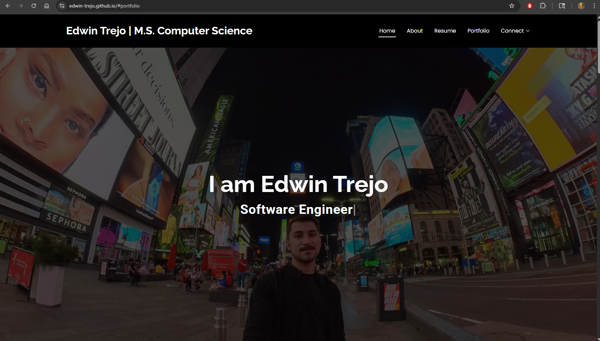

# Portfolio Website

## Edwin Trejo – Portfolio Website

Hi there!  
Welcome to my personal portfolio website — a space where I showcase my work in **Cybersecurity**, **Artificial Intelligence**, and **Software Engineering**.  
This site highlights some of my favorite projects, research experiences, and the journey I’ve taken as a computer scientist.

---

### Live Website
[**Visit My Portfolio**](https://edwin-trejo.github.io)  

  
*(screenshot of the homepage )*

---

### About
This portfolio is a place to bring together:
- My ongoing **research and graduate work** at UTEP  
- Professional experiences from **Sandia National Laboratories** and other roles  
- Personal projects that combine AI, ML, and Cybersecurity  
- My interests in tech, problem-solving, and creativity  

I built this portfolio using the [**DevFolio**](https://bootstrapmade.com/devfolio-bootstrap-portfolio-html-template/) template and customized it to better reflect who I am and what I do.

---

### Tech Stack
- **Frontend:** HTML5, CSS3, JavaScript  
- **Frameworks:** Bootstrap 5, AOS Animations  
- **Hosting:** GitHub Pages  

---

